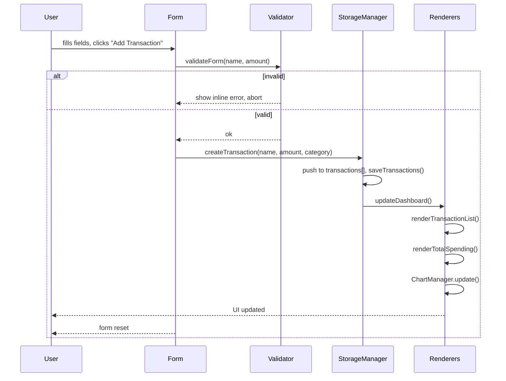

# Design Document

## Overview

Expense & Budget Visualizer is a client-side-only single-page application (SPA) that runs entirely in the browser. There is no server, no build step, and no external runtime dependencies beyond Chart.js loaded via CDN. All state lives in JavaScript module-level variables during the session and is persisted to `localStorage` on every mutating operation.

The application is divided into three layers:

1. **Persistence layer** (`Storage_Manager`) — reads and writes `localStorage` keys.
2. **Business logic layer** — validates inputs, calculates aggregates, manages in-memory state.
3. **Presentation layer** — renders the DOM, updates the Chart.js instance, applies themes.

All three layers are implemented in a single file (`js/script.js`) and coordinated by a thin orchestration module. The HTML shell (`index.html`) carries semantic structure and the `<link>` / `<script>` tags; `css/style.css` owns all visual rules.

### Key Design Goals

- **Zero build step** — the repo can be opened directly in a browser or served from GitHub Pages as-is.
- **Single source of truth** — `localStorage` is the authoritative store; in-memory state is always derived from it on load and kept in sync on every mutation.
- **Minimal global scope** — all symbols are wrapped in an IIFE or declared with `const`/`let` at module scope to avoid polluting `window`.
- **Accessibility** — interactive controls carry `aria-label` attributes; color contrast meets WCAG 2.1 AA (4.5:1).

---

## Architecture

### Module Responsibilities

```
index.html
│
├── css/style.css          – Design tokens, layout, dark/light themes
│
└── js/script.js
    │
    ├── [Constants]        – DEFAULT_CATEGORIES, LS_KEYS, CHART_PALETTE
    ├── [State]            – transactions[], customCategories[], chartInstance
    │
    ├── StorageManager     – load/save to localStorage, JSON parse/stringify
    ├── Validator          – pure validation functions, return {ok, error}
    ├── ChartManager       – Chart.js init/update/destroy
    │
    ├── render*()          – DOM mutation functions (no side-effects on state)
    ├── handler*()         – event handlers that mutate state then call render*()
    └── init()             – bootstrap: load state, render, attach events
```

### Data Flow

```
User action
    │
    ▼
handler*()  ──► Validator.validate*()
    │                   │ invalid → show inline error
    │           valid   │
    ▼                   ▼
  mutate in-memory state (transactions[], customCategories[])
    │
    ▼
StorageManager.save*()   ──► localStorage
    │
    ▼
render*()
  ├── renderTransactionList()
  ├── renderTotalSpending()
  ├── ChartManager.update()
  ├── renderMonthlySummary()
  └── (renderCategoryDropdown if categories changed)
```

### Sequence — Adding a Transaction



---

## Components and Interfaces

### HTML Components (IDs and Roles)

| ID / Selector | Semantic element | Purpose |
|---|---|---|
| `#app` | `<div>` | Root IIFE scope anchor |
| `header.app-header` | `<header>` | App title + `#theme-toggle` button |
| `#theme-toggle` | `<button>` | Switches light/dark, holds `aria-label` |
| `#total-spending` | `<p>` / `<span>` | Shows formatted IDR total |
| `#expense-form` | `<form>` | Expense input; `novalidate` attribute |
| `#item-name` | `<input type="text">` | Item Name field |
| `#amount` | `<input type="number">` | Amount field |
| `#category` | `<select>` | Category dropdown |
| `#add-btn` | `<button type="submit">` | "Add Transaction" |
| `#item-name-error` | `<span aria-live="polite">` | Inline validation error |
| `#amount-error` | `<span aria-live="polite">` | Inline validation error |
| `#custom-category-form` | `<form>` | New category input + submit |
| `#new-category-name` | `<input type="text">` | Category name field |
| `#category-list` | `<ul>` | Renders existing Custom_Categories with delete buttons |
| `#transaction-list` | `<ul>` | Scrollable expense list |
| `#chart-container` | `<div>` | Wraps `<canvas id="spending-chart">` |
| `#spending-chart` | `<canvas>` | Chart.js render target |
| `#monthly-summary` | `<section>` | Month selector + breakdown |
| `#month-selector` | `<select>` | Populated with available months |
| `#monthly-stats` | `<div>` | Total, count, top category |
| `#monthly-breakdown` | `<ul>` | Per-category totals for selected month |
| `#delete-modal` | `<dialog>` / `<div role="dialog">` | Confirmation prompt for deletion |

### JavaScript Public Interface (module-internal)

```js
// --- StorageManager ---
StorageManager.loadTransactions()        // → Transaction[]
StorageManager.saveTransactions(arr)     // → void  (may throw, caught internally)
StorageManager.loadCustomCategories()    // → string[]
StorageManager.saveCustomCategories(arr) // → void
StorageManager.loadTheme()               // → 'light' | 'dark'
StorageManager.saveTheme(theme)          // → void

// --- Validator ---
Validator.validateTransaction(name, amount)
// → { ok: boolean, nameError?: string, amountError?: string }

Validator.validateCategory(name, existingCategories)
// → { ok: boolean, error?: string }

// --- ChartManager ---
ChartManager.init(canvasId, data, isDark) // → void (stores instance)
ChartManager.update(categoryTotals)       // → void
ChartManager.updateTheme(isDark)          // → void
ChartManager.destroy()                    // → void

// --- Business Logic ---
calculateTotalSpending(transactions)      // → number
calculateCategoryTotals(transactions)     // → Map<string, number>
getMonthlyGroups(transactions)            // → Map<string, Transaction[]>
getMonthlySummaryStats(transactions)
// → { total, count, topCategory, breakdown: [{category, total}] }

// --- Renderers ---
renderTransactionList(transactions)       // → void
renderTotalSpending(total)                // → void
renderCategoryDropdown(allCategories)     // → void
renderCategoryManager(customCategories)   // → void
renderMonthlySummary(monthlyGroups, selectedKey) // → void

// --- Handlers ---
handleAddTransaction(event)              // → void
handleDeleteTransaction(id)              // → void  (shows modal first)
handleConfirmDelete(id)                  // → void
handleAddCategory(event)                 // → void
handleDeleteCategory(name)               // → void
handleMonthChange(monthKey)              // → void
handleThemeToggle()                      // → void

// --- Orchestration ---
updateDashboard()                        // → void  (calls all renderers)
init()                                   // → void  (bootstrap on DOMContentLoaded)
```

---

## Data Models

### Transaction Object

```js
/**
 * @typedef {Object} Transaction
 * @property {string} id        - Unique ID: `${Date.now()}-${Math.random().toString(36).slice(2)}`
 * @property {string} name      - Expense name, 1–100 characters
 * @property {number} amount    - Positive integer, 1–999,999,999
 * @property {string} category  - Category name string
 * @property {string} date      - ISO 8601 UTC timestamp (new Date().toISOString())
 */
```

### Local Storage Schema

| Key | Type | Description |
|---|---|---|
| `"expenseTransactions"` | `Transaction[]` (JSON) | All expense records |
| `"customCategories"` | `string[]` (JSON) | User-defined category names |
| `"preferredTheme"` | `"light" \| "dark"` (raw string) | Active theme |

### In-Memory State

```js
let transactions = [];       // Transaction[] — source of truth for all renders
let customCategories = [];   // string[]
let chartInstance = null;    // Chart.js instance
let selectedMonth = null;    // string key "YYYY-MM" | null
```

### Category Totals

`calculateCategoryTotals(transactions)` returns a plain `Map<string, number>` keyed by category name. This is the canonical input for `ChartManager.update()`.

### Monthly Groups

`getMonthlyGroups(transactions)` returns a `Map<string, Transaction[]>` keyed by `"YYYY-MM"` derived from `transaction.date` interpreted in the device's local timezone (using `Date` constructor + `getFullYear` / `getMonth`).

---

## CSS Architecture

### Design Tokens (Custom Properties)

All colors, spacing, and typography are declared as CSS custom properties on `:root` (light mode) and overridden under `[data-theme="dark"]` on `<html>`.

```css
:root {
  /* Color palette */
  --color-bg:        #F5F5F5;
  --color-surface:   #FFFFFF;
  --color-primary:   #66BB6A;
  --color-primary-dark: #1B5E20;
  --color-secondary: #A5D6A7;
  --color-accent:    #89A482;
  --color-text:      #1B1B1B;
  --color-text-muted:#555555;
  --color-border:    #D0D0D0;
  --color-error:     #D32F2F;

  /* Spacing scale */
  --space-xs: 4px;
  --space-sm: 8px;
  --space-md: 16px;
  --space-lg: 24px;
  --space-xl: 32px;

  /* Typography */
  --font-family: 'Segoe UI', system-ui, sans-serif;
  --font-size-sm: 0.875rem;
  --font-size-base: 1rem;
  --font-size-lg: 1.25rem;
  --font-size-xl: 1.5rem;

  /* Border radius */
  --radius-sm: 4px;
  --radius-md: 8px;
  --radius-lg: 12px;
}

[data-theme="dark"] {
  --color-bg:        #121212;
  --color-surface:   #1E1E1E;
  --color-primary:   #66BB6A;
  --color-primary-dark: #A5D6A7;
  --color-secondary: #388E3C;
  --color-accent:    #89A482;
  --color-text:      #E8F5E9;
  --color-text-muted:#9E9E9E;
  --color-border:    #333333;
  --color-error:     #EF9A9A;
}
```

### Layout Strategy

**Desktop (≥768px)** — CSS Grid two-column layout on the main content area:

```css
.main-grid {
  display: grid;
  grid-template-columns: minmax(30%, 400px) 1fr;
  gap: var(--space-lg);
}
```

Left column: Total Spending card → Expense Form → Custom Category manager.  
Right column: Transaction List → Pie Chart → Monthly Summary.

**Mobile (<768px)** — single column via media query:

```css
@media (max-width: 767px) {
  .main-grid {
    grid-template-columns: 1fr;
  }
}
```

Stack order enforced by DOM order: header → total → form → category → list → chart → monthly.

### Responsive Principles

- All widths use `%`, `fr`, or `clamp()`; no fixed pixel widths on containers.
- `min-width: 0` on grid children to prevent overflow.
- `overflow-x: hidden` on `body`; `overflow-y: auto` on `#transaction-list` with a `max-height`.
- Font sizes use `rem`; no pixel-locked font sizes below 14px.
- Zoom to 200%: because all widths are fluid, reflow happens naturally.

---

## Chart.js Integration

### Initialization

Chart.js (v4.x) is loaded via CDN before `script.js` in `index.html`:

```html
<script src="https://cdn.jsdelivr.net/npm/chart.js@4/dist/chart.umd.min.js"></script>
<script src="js/script.js" defer></script>
```

`ChartManager.init()` is called once in `init()` after the DOM is ready. It stores the instance in the module-level `chartInstance` variable.

### Chart Configuration

```js
{
  type: 'pie',
  data: {
    labels: [...categoryNames],
    datasets: [{
      data: [...amounts],
      backgroundColor: assignPaletteColors(categoryNames.length),
      borderWidth: 2,
      borderColor: isDark ? '#1E1E1E' : '#FFFFFF'
    }]
  },
  options: {
    responsive: true,
    plugins: {
      title: {
        display: true,
        text: 'Spending Distribution by Category',
        color: isDark ? '#E8F5E9' : '#1B5E20',
        font: { size: 16, weight: 'bold' }
      },
      legend: {
        labels: { color: isDark ? '#E8F5E9' : '#1B1B1B' }
      }
    }
  }
}
```

### Palette Color Assignment

```js
const CHART_PALETTE = ['#E8F5E9', '#A5D6A7', '#66BB6A', '#1B5E20', '#89A482'];

function assignPaletteColors(count) {
  return Array.from({ length: count }, (_, i) => CHART_PALETTE[i % CHART_PALETTE.length]);
}
```

### Empty State

When `transactions` is empty, `ChartManager.update()` calls `chartInstance.destroy()`, hides `#chart-container`, and shows a `<p id="chart-empty-message">` element instead.

### Theme Updates

`ChartManager.updateTheme(isDark)` modifies `chartInstance.options.plugins.title.color`, `chartInstance.options.plugins.legend.labels.color`, and dataset `borderColor`, then calls `chartInstance.update()`.

---

## State Management Approach

The application uses a simple **centralized mutable state** pattern without a framework:

1. **Load** — `init()` calls `StorageManager.loadTransactions()` and `StorageManager.loadCustomCategories()`, populating `transactions[]` and `customCategories[]`.
2. **Mutate** — every handler that changes data (add, delete) updates the in-memory arrays first, then calls `StorageManager.save*()` to persist.
3. **Render** — after every mutation, `updateDashboard()` is called, which invokes all renderer functions. Renderers are pure with respect to the DOM: they overwrite the relevant section entirely from the current state.
4. **No partial updates** — renderers always re-derive from the full `transactions[]` array, ensuring consistency.

This avoids stale UI states and keeps the code easy to reason about at the cost of slightly more DOM work per update — acceptable for the expected dataset sizes.

---

## Error Handling

### Inline Validation Errors

- Displayed in `<span aria-live="polite">` elements adjacent to each field.
- Cleared on the next successful submission or when the user starts typing (`input` event).
- Never uses `alert()`.

### localStorage Write Failures

`StorageManager.saveTransactions()` and `saveCustomCategories()` wrap `localStorage.setItem()` in a `try/catch`. On exception:
- The in-memory array is already updated (the user sees their change in the UI).
- A non-blocking toast notification is shown for 4 seconds: "Data could not be saved. Changes may be lost on refresh."
- The mutation is not rolled back, matching the requirement to "retain current in-memory state".

### localStorage Read / Parse Failures

`StorageManager.loadTransactions()` and `loadCustomCategories()` wrap `JSON.parse()` in a `try/catch`. On a `SyntaxError`:
- The corrupted key is ignored.
- The corresponding array is initialized to `[]`.
- No error is shown to the user (silent recovery, per Requirement 8.8).

### localStorage Delete Failures (Requirement 2.8)

`StorageManager.saveTransactions()` is called after removing a transaction from the array. If it throws:
- The transaction is re-inserted into `transactions[]` at its original position.
- The UI is re-rendered to show the transaction still present.
- An error message is displayed: "Deletion could not be completed. Please try again."

### Chart.js Errors

If `Chart` is not defined (CDN load failure), `ChartManager.init()` catches the `ReferenceError` and displays a static message in `#chart-container`: "Chart could not be loaded. Please check your internet connection."

---

## Testing Strategy

### Unit Tests

Unit tests cover specific examples and edge cases for the pure business logic and validation functions:

- `Validator.validateTransaction` — valid inputs, empty name, whitespace-only name, name > 100 chars, amount = 0, amount < 0, amount > 999,999,999, non-integer amount.
- `Validator.validateCategory` — valid name, duplicate (case-insensitive), empty, > 50 chars.
- `calculateTotalSpending` — empty array, single transaction, multiple transactions, large amounts.
- `calculateCategoryTotals` — grouping, accumulation, zero-amount exclusion.
- `getMonthlyGroups` — correct month-key derivation, multi-month grouping, empty input.
- `getMonthlySummaryStats` — alphabetical tie-break for top category, descending sort of breakdown.
- `StorageManager` — round-trip serialize/deserialize, corrupt JSON handling, missing key handling.

A vanilla test runner (no external framework required; plain `console.assert` or a micro-framework like [uvu](https://github.com/lukeed/uvu)) can be used since there is no build step.

### Property-Based Tests

Property-based tests use [fast-check](https://github.com/dubzzz/fast-check) loaded via CDN in a separate `test.html` file. Each test runs a minimum of 100 iterations. Tests are tagged with a comment referencing the design property they validate.

```js
// Feature: expense-budget-visualizer, Property N: <property_text>
fc.assert(fc.property(fc.arbitrary(...), (input) => { /* check */ }), { numRuns: 100 });
```

### Integration / End-to-End

Manual smoke tests in Chrome, Firefox, Edge, and Safari verify:
- Application loads without console errors.
- Theme persists across reload.
- Data persists across reload.
- Chart renders and updates correctly.
- Layout has no horizontal overflow at 320px, 768px, 1440px, and 2560px.
- 200% zoom does not introduce horizontal scrollbar.

---

## Correctness Properties

*A property is a characteristic or behavior that should hold true across all valid executions of a system — essentially, a formal statement about what the system should do. Properties serve as the bridge between human-readable specifications and machine-verifiable correctness guarantees.*

### Property 1: Amount validation accepts exactly the valid range

*For any* integer value, `Validator.validateTransaction` SHALL accept it as a valid amount if and only if it is in the closed range [1, 999,999,999]. Any value outside that range (zero, negative, or greater than 999,999,999) SHALL be rejected with an error.

**Validates: Requirements 1.2, 1.6**

---

### Property 2: Name length validation

*For any* string, `Validator.validateTransaction` SHALL reject it as the item name if and only if it is empty (length 0) or exceeds 100 characters; strings of length 1–100 SHALL be accepted.

**Validates: Requirements 1.5, 1.7**

---

### Property 3: Transaction creation preserves input fields

*For any* valid combination of (name, amount, category), calling `addTransaction` SHALL produce a Transaction object whose `name`, `amount`, and `category` fields are identical to the supplied inputs, whose `id` is a non-empty unique string, and whose `date` is a parseable ISO 8601 UTC timestamp.

**Validates: Requirements 1.8**

---

### Property 4: IDR amount formatting round-trip

*For any* positive integer amount in [1, 999,999,999], formatting it as IDR currency (dot-separated thousands, "Rp" prefix) and then extracting the numeric value back by removing the prefix and dots SHALL return the original integer.

**Validates: Requirements 2.1, 3.1**

---

### Property 5: Transaction list is always newest-first

*For any* array of Transactions with distinct ISO 8601 timestamps, `renderTransactionList` SHALL render them in descending order by timestamp — i.e., for every adjacent pair rendered, the earlier item in the DOM has a timestamp ≥ the later item's timestamp.

**Validates: Requirements 2.2**

---

### Property 6: Cancelling deletion leaves state unchanged

*For any* transactions array and any transaction id present in it, if the confirmation modal's cancel action is triggered, the transactions array SHALL remain byte-for-byte identical (same length, same elements in same order) and `localStorage` SHALL not be modified.

**Validates: Requirements 2.6**

---

### Property 7: Confirmed deletion removes exactly the targeted transaction

*For any* transactions array and any transaction id present in it, after `deleteTransaction(id)` succeeds, the resulting transactions array SHALL not contain any element whose `id` equals the deleted id, and all other elements SHALL remain present and unchanged.

**Validates: Requirements 2.7**

---

### Property 8: Total spending equals the sum of all transaction amounts

*For any* array of Transactions, `calculateTotalSpending` SHALL return a value equal to the arithmetic sum of all `amount` fields. Specifically, `calculateTotalSpending([])` SHALL equal 0, and for a non-empty array the result SHALL equal `arr.reduce((s, t) => s + t.amount, 0)`.

**Validates: Requirements 3.1, 3.3, 3.4**

---

### Property 9: Category totals exclude zero-amount categories

*For any* transactions array, `calculateCategoryTotals` SHALL return a Map containing only entries for categories whose summed transaction amounts are strictly greater than zero. No entry with a value of 0 or less SHALL appear in the Map.

**Validates: Requirements 4.3**

---

### Property 10: Chart palette colors cycle through the defined palette

*For any* non-negative integer N, `assignPaletteColors(N)` SHALL return an array of length N where every element at index i equals `CHART_PALETTE[i % CHART_PALETTE.length]`, using only the five defined palette values (#E8F5E9, #A5D6A7, #66BB6A, #1B5E20, #89A482).

**Validates: Requirements 4.4, 4.8**

---

### Property 11: Category name duplicate rejection is case-insensitive

*For any* list of existing categories and any candidate name, `Validator.validateCategory` SHALL reject the candidate if and only if there exists an existing category whose name, when lowercased, equals the candidate's name when lowercased.

**Validates: Requirements 5.2**

---

### Property 12: Category name length validation

*For any* string, `Validator.validateCategory` SHALL reject it if it is empty (length 0) or exceeds 50 characters; strings of length 1–50 that are not duplicates SHALL be accepted.

**Validates: Requirements 5.3**

---

### Property 13: Custom category localStorage round-trip

*For any* array of valid category name strings, calling `StorageManager.saveCustomCategories(arr)` followed immediately by `StorageManager.loadCustomCategories()` SHALL return an array whose elements are identical to `arr` in the same order.

**Validates: Requirements 5.4, 8.2, 8.4**

---

### Property 14: Category deletion is rejected when the category is in use

*For any* transactions array and any category name that appears as the `category` field in at least one transaction in that array, attempting to delete that category SHALL be rejected and the customCategories array SHALL remain unchanged.

**Validates: Requirements 5.7**

---

### Property 15: Monthly grouping matches local-timezone month of ISO 8601 timestamp

*For any* Transaction, `getMonthlyGroups` SHALL place it in the group keyed by the "YYYY-MM" string that corresponds to the calendar month and year of the transaction's `date` timestamp interpreted in the device's local timezone (i.e., using `new Date(date).getFullYear()` and `new Date(date).getMonth()`).

**Validates: Requirements 6.1**

---

### Property 16: Monthly transaction count equals the number of transactions in that month

*For any* array of transactions belonging to a single calendar month, `getMonthlySummaryStats` SHALL return a `count` value equal to the length of the input array.

**Validates: Requirements 6.5**

---

### Property 17: Monthly top category respects alphabetical tiebreak

*For any* transactions array for a given month, `getMonthlySummaryStats` SHALL return as `topCategory` the category name with the highest total spending; when two or more categories share the highest total, it SHALL return the one that comes first alphabetically (case-insensitive ascending sort).

**Validates: Requirements 6.6**

---

### Property 18: Monthly breakdown is sorted in descending order by total spending

*For any* transactions array for a given month, `getMonthlySummaryStats.breakdown` SHALL be an array sorted in non-increasing order by each entry's `total` value — i.e., for every adjacent pair `[a, b]` in the result, `a.total >= b.total`.

**Validates: Requirements 6.7**

---

### Property 19: Theme toggle is its own inverse (round-trip)

*For any* current theme state ('light' or 'dark'), calling `handleThemeToggle()` twice in succession SHALL restore the application to the original theme state — the `data-theme` attribute on `<html>` after two toggles SHALL equal its value before any toggle.

**Validates: Requirements 7.3, 7.4, 7.5**

---

### Property 20: Theme persistence round-trip

*For any* theme string in {'light', 'dark'}, calling `StorageManager.saveTheme(theme)` followed immediately by `StorageManager.loadTheme()` SHALL return the same theme string.

**Validates: Requirements 7.7, 7.8**

---

### Property 21: Transaction array JSON serialization round-trip

*For any* valid Transaction array, calling `StorageManager.saveTransactions(arr)` followed immediately by `StorageManager.loadTransactions()` SHALL return an array of the same length where each element at index i has identical values for all fields (`id`, `name`, `amount`, `category`, `date`) compared to `arr[i]`.

**Validates: Requirements 8.1, 8.3, 8.7**
